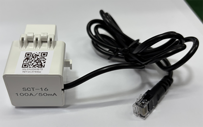
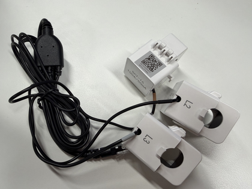

# Accessories

## CT Current Transformer

This device is equipped with split-core CT current transformers for single/three-phase meters, with a specification of **100A/50mA, class 0.5**.

| Type | Photo |
| --- | --- |
| Single-phase meter CT |  |
| Three-phase meter CT |  |
