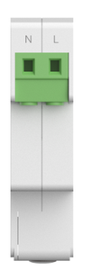
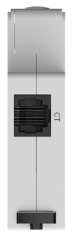
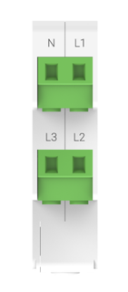
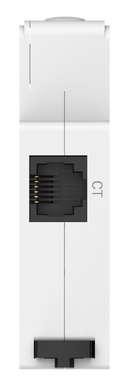
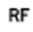

# Appearance

## MR1-D5-W, MR1-D5-WR Appearance and Interface Definition

  
  

| Interface | Name | Description |
| --- | --- | --- |
|  | N | Neutral terminal, meter power input |
|  | L | Live terminal, meter power input |
|  | CT | CT port, CT current sampling port |

## MR3-D5-W, MR3-D5-WR Appearance and Interface Definition

  
  

| Interface | Name | Description |
| --- | --- | --- |
|  | N | Neutral terminal, meter power input |
|  | L1 | Phase A live terminal, meter power input |
|  | L2 | Phase B live terminal, meter power input |
|  | L3 | Phase C live terminal, meter power input |
|  | CT | CT port, CT current sampling port |

## MR1-D5-WR, MR3-D5-WR Indicator Descriptions

| Indicator | Meaning | Status Description |
| --- | --- | --- |
|  | Power (red) | Steady on: power indicator, the meter is powered normally. Off: the meter is not powered or is abnormal. |
|  | Network (WiFi) (green) | Steady on: the device is connected to the cloud platform. Blinking at 1s intervals: the device is connected to the router or has obtained an IP. Fast blinking at 100ms intervals: the device is upgrading. Off: the device is not connected to the router or has not obtained an IP. |
|  | LoRa (green) | Steady on: LoRa connection established. Off: LoRa not connected. |

## MR1-D5-W, MR3-D5-W Indicator Descriptions

| Indicator | Meaning | Status Description |
| --- | --- | --- |
|  | Power (red) | Steady on: power indicator, the meter is powered normally. Off: the meter is not powered or is abnormal. |
|  | Network (WiFi) (green) | Steady on: the device is connected to the cloud platform. Blinking at 1s intervals: the device is connected to the router or has obtained an IP. Fast blinking at 100ms intervals: the device is upgrading. Off: the device is not connected to the router or has not obtained an IP. |

## Button Description

| Button | Meaning | Function Description |
| --- | --- | --- |
|  | RESET | Long press for 10 seconds to restore factory settings. All indicators stay on for 2s and then return to normal status. |
