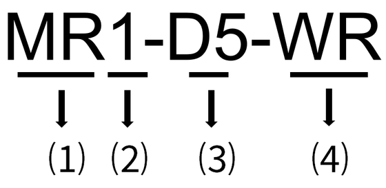

# Model Description

This document mainly covers the following specific models: **MR1-D5-W, MR1-D5-WR, MR3-D5-W, MR3-D5-WR**.

| No. | Meaning | Value |
| --- | --- | --- |
| ⑴ | Product identifier | MR: Multi-function Energy Meter. |
| ⑵ | Number of phases | 1: Single-phase 3: Three-phase |
| ⑶ | Product generation | D5: 5th generation product. |
| ⑷ | Communication | ● R: LoRa communication supported. ● W: WiFi communication supported. |
