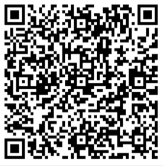
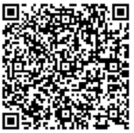

# UniEnergy

If you are a home user of a PV power station, we recommend using **UniEnergy**.

For detailed mobile app operations, click the link [UniEnergy App User Manual](https://1m29l9z267.k.topthink.com/@solarmansmart-app_en/1.xiaomaizhidianAPPyingyong.html) or scan the QR code below.

For detailed web platform operations, click the link [UniEnergy Web User Manual](https://1m29l9z267.k.topthink.com/@solarmanbusiness-app_en/1xiaomaishangjiabanAPPyingyong.html) or scan the QR code below.

