# App Usage

Scan the QR codes below to download the app, then complete registration and login. Currently, the **Energy Ease** and **UniEnergy** apps are supported.

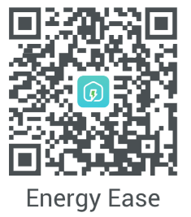   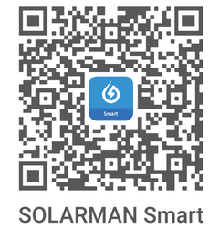

Make sure the meter's installation area is covered by a stable WiFi network, and that you know the WiFi name and password.

## (1) Energy Ease

The following uses the interface of Energy Ease V2.2.10 as an example. Use the Energy Ease app when using LoRa functions.

1. Open the "Energy Ease" app on your smartphone and complete registration and login.
2. On the Home page, tap the "+" button and select "Add Device". Enable location services, tap the P1 reader with the matching SN under "Discover Devices", or use "Manual Add", select the specified brand, scan the QR code on the product itself or manually enter the device SN to complete adding the device.

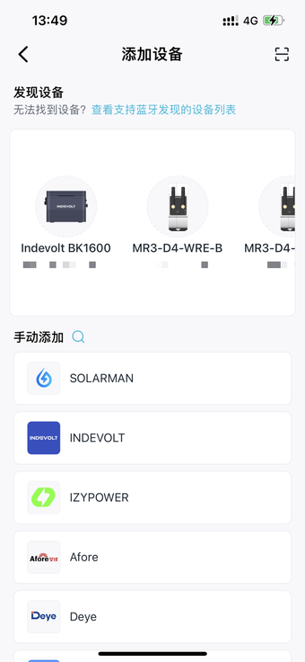

3. On the "Access Mode" screen, select the communication method based on the actual usage scenario and complete the subsequent configuration process.
   - WiFi access: suitable for environments with a stable WiFi network.
   - LoRa wireless access: suitable for long-distance scenarios or areas without WiFi coverage (requires a LoRa gateway or micro-storage device).

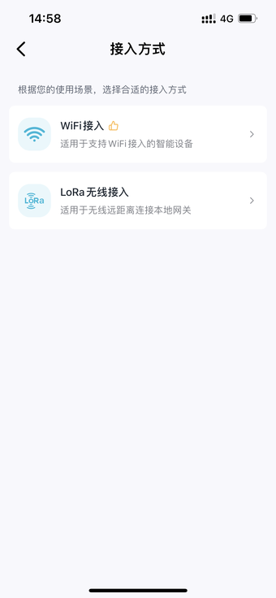

> Note: If the initial configuration is incorrect, you can switch it in the settings on the device page.

4. When selecting WiFi access, connect to a 2.4G WiFi network, enter the WiFi name and password, and tap Confirm.

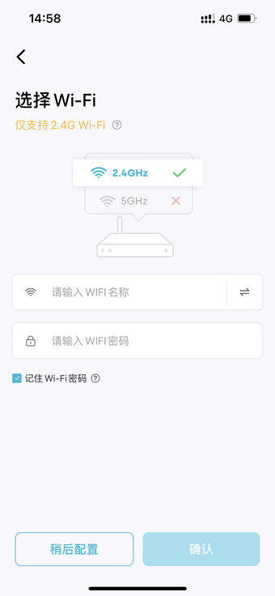

5. When selecting LoRa wireless access, select the device to be bound and establish a long-distance data connection.

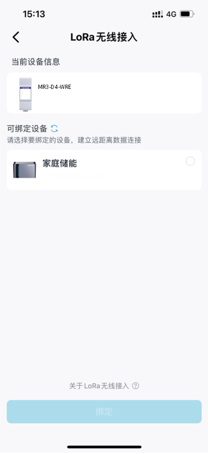

6. After the device successfully connects to the network, tap Confirm to go to the device page, select the corresponding device to view related data.

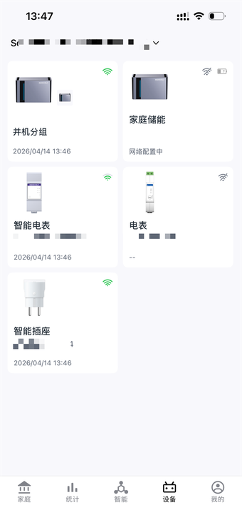

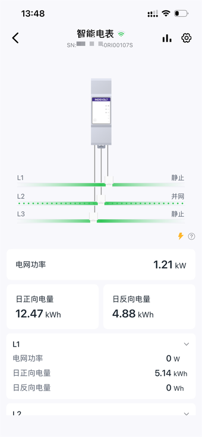

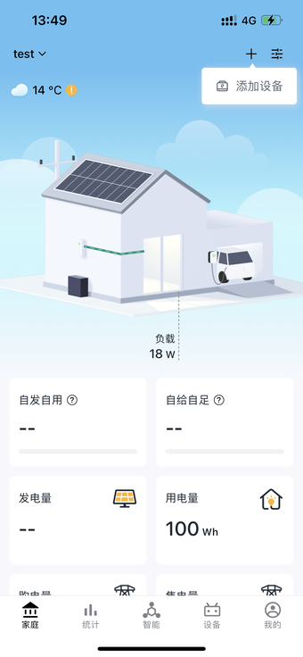

## (2) UniEnergy

The following uses the interface of UniEnergy V2.3.8 as an example for reference when using the UniEnergy app.

1. Open the "UniEnergy" app on your smartphone and complete registration and login.
2. On the Home page, tap the "+" button and select "Add Device". Tap "Scan", scan the QR code on the product itself or manually enter the device SN to complete adding the device.

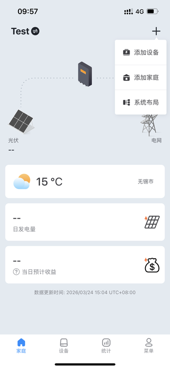

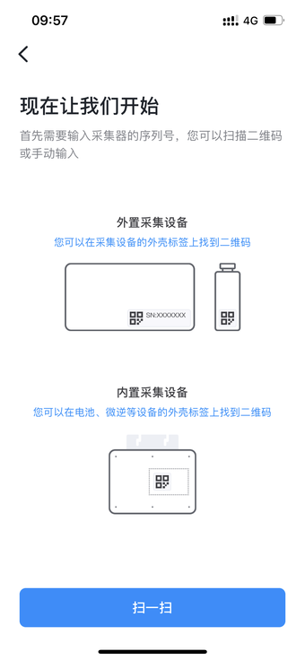

3. Perform network configuration, enter the WiFi name and password, tap Confirm, and a configuration success message will be displayed.

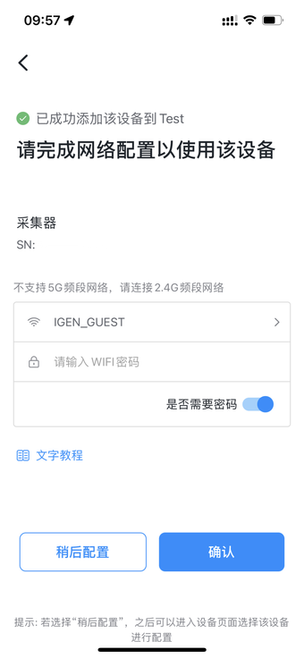

4. After the device successfully connects to the network, tap Confirm to go to the device page and view related data.
