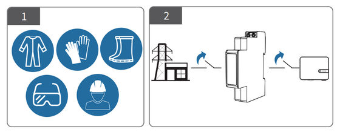
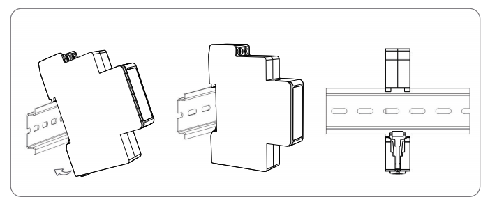
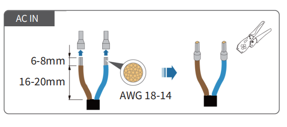
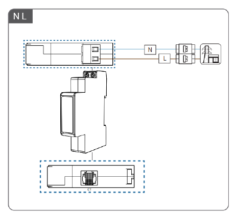
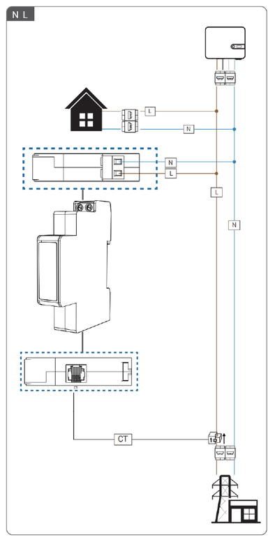

# Wiring

## Single-Phase Meter Installation Steps

(Applicable to MR1-D5-W, MR1-D5-WR)

### Installation Tools

This product must be installed by experienced electricians or professionals wearing dedicated protective equipment that meets relevant safety standards. Before installation, read this manual carefully in full and make sure you fully understand all safety precautions and wiring requirements.

:::danger Warning
All wiring work must be carried out with the power completely disconnected and verified de-energized. Installation or wiring while energized is strictly prohibited.
:::

### Mechanical Installation

- Based on the meter dimensions, plan the installation position on the 35mm standard DIN rail in the distribution box, ensuring sufficient space for wiring and maintenance.
- Align the slot on the back of the meter with the top edge of the rail, and press down until the bottom latch securely locks onto the rail. To ensure system safety, the distribution box should be equipped with a suitable surge protective device (SPD).

### Electrical Wiring

1. Use wire strippers to strip 6~8mm of insulation from the wire end, then crimp with a terminal matching the wire gauge.

2. Connect the neutral wire (N) and the live wire (L) to the meter terminals according to the labels.

3. Pass the main live wire (L) through the CT aperture. Ensure the incoming power direction matches the P1 side marked on the CT. Connect the terminals of the current transformer (CT) to the CT terminals on the meter.

4. Only restore power after all wiring is complete and has been double-checked. After power-on, observe whether the power indicator on the meter stays on to confirm that the meter is powered.
