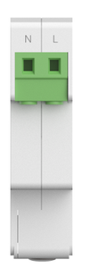
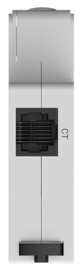
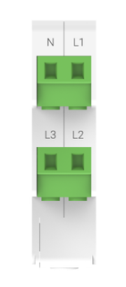
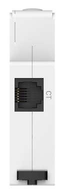
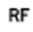

# 外观介绍

## MR1-D5-W、MR1-D5-WR 外观和接口定义

  
  

| 接口 | 名称 | 说明 |
| --- | --- | --- |
|  | N | 零线接口，电表供电输入，零线接口 |
|  | L | 火线接口，电表供电输入，火线接口 |
|  | CT | CT 端口，CT 电流采集端口 |

## MR3-D5-W、MR3-D5-WR 外观和接口定义

  
  

| 接口 | 名称 | 说明 |
| --- | --- | --- |
|  | N | 零线接口，电表供电输入，零线接口 |
|  | L1 | A 相火线接口，电表供电输入，火线接口 |
|  | L2 | B 相火线接口，电表供电输入，火线接口 |
|  | L3 | C 相火线接口，电表供电输入，火线接口 |
|  | CT | CT 端口，CT 电流采集端口 |

## MR1-D5-WR、MR3-D5-WR 指示灯说明

| 指示灯标识 | 指示灯含义 | 状态说明 |
| --- | --- | --- |
|  | 电源（红色） | 灯常亮：电源指示灯，电表供电正常。 灯不亮：电表未供电或异常。 |
|  | 网络（WiFi）（绿色） | 灯常亮：设备连上云平台。 1s 间隔闪烁：设备连上路由或获取到 IP。 100ms 间隔快闪：设备升级状态。 灯灭：设备未连接到路由或未获取 IP。 |
|  | LoRa（绿色） | 灯常亮：LoRa 连接成功。 灯灭：LoRa 未连接。 |

## MR1-D5-W、MR3-D5-W 指示灯说明

| 指示灯标识 | 指示灯含义 | 状态说明 |
| --- | --- | --- |
|  | 电源（红色） | 灯常亮：电源指示灯，电表供电正常。 灯不亮：电表未供电或异常。 |
|  | 网络（WiFi）（绿色） | 灯常亮：设备连上云平台。 1s 间隔闪烁：设备连上路由或获取到 IP。 100ms 间隔快闪：设备升级状态。 灯灭：设备未连接到路由或未获取 IP。 |

## 按键说明

| 按键标识 | 按键含义 | 功能说明 |
| --- | --- | --- |
|  | RESET | 长按 10 秒可恢复出厂设置。 所有灯常亮 2s 恢复正常状态。 |
