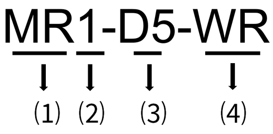

# 型号说明

本文主要涉及产品具体型号：**MR1-D5-W、MR1-D5-WR、MR3-D5-W、MR3-D5-WR**。

| 序号 | 含义 | 取值 |
| --- | --- | --- |
| ⑴ | 产品标识 | MR：多功能电能表。 |
| ⑵ | 相数 | 1：单相 3：三相 |
| ⑶ | 产品代际 | D5：第 5 代产品。 |
| ⑷ | 通信方式 | ● R：支持 LoRa 通信。 ● W：支持 WiFi 通信。 |
