# APP 使用

请扫描下方二维码下载应用程序，并完成注册和登录。目前支持 **Energy Ease APP** 和 **小麦智电 APP**。

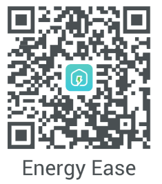   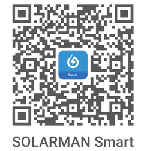

请确保电表使用区域已覆盖稳定的 WiFi 网络，并知晓 WiFi 名称和密码。

## （一）Energy Ease

以下为 Energy Ease V2.2.10 软件版本的界面图为例进行说明，使用 LoRa 功能请使用 Energy Ease APP。

1. 请在智能手机上打开“Energy Ease”应用程序，完成注册和登录。
2. 在家庭页面点击 “+” 按钮，选择“添加设备”。开启定位，通过“发现设备”点击对应 SN 号的 P1 读表器，或“手动添加”，选择指定品牌，扫描产品本身的二维码或手动输入设备 SN 号，完成添加设备。

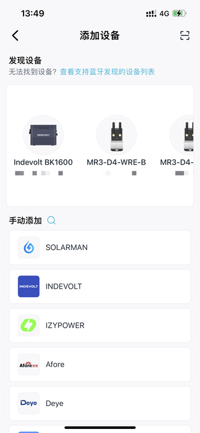

3. 进入“接入方式”界面，根据实际使用场景选择通信方式，完成后续配置流程。
   - WiFi 接入：适用于有稳定 WiFi 网络的环境。
   - LoRa 无线接入：适用于远距离或无 WiFi 覆盖场景（需配合 LoRa 网关或微储设备）。

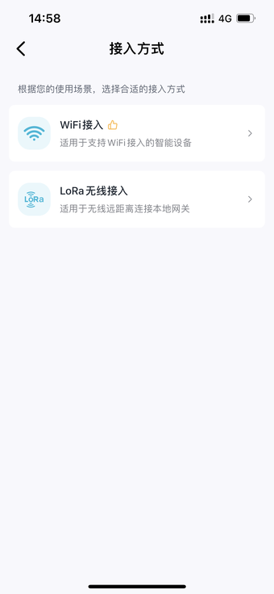

> 提醒：初次配置错误，可以在设备页面的设置中进行切换。

4. 选择 WiFi 接入时，连接 2.4G WiFi，输入 WiFi 名称和密码，点击确认。

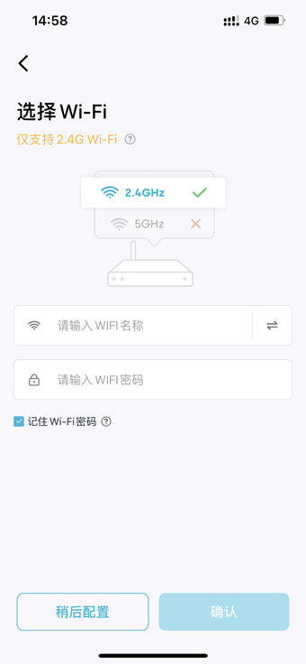

5. 选择 LoRa 无线接入时，选择要绑定的设备，建立远距离数据连接。

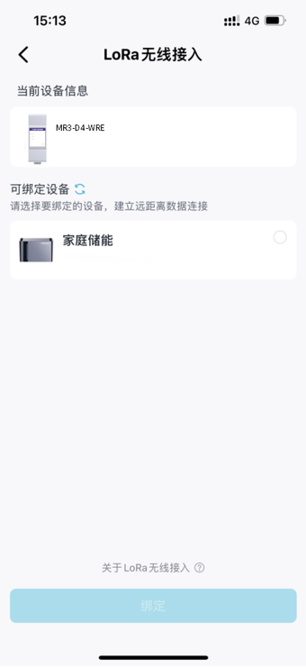

6. 设备成功连接网络后，点击确认跳转到设备页面，选择对应的设备查看相关的数据。

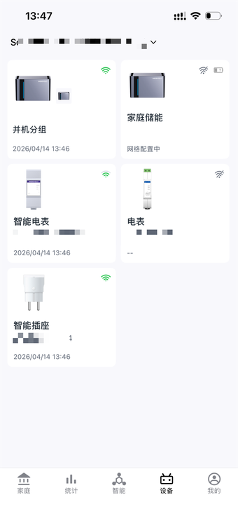

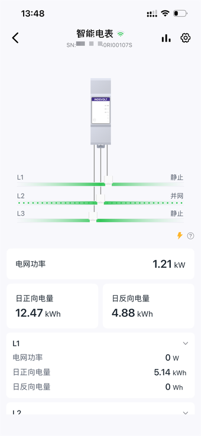

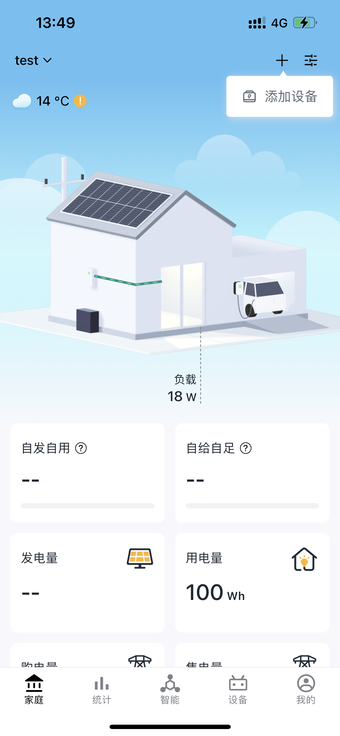

## （二）小麦智电

以下为小麦智电 V2.3.8 软件版本的界面图为例进行说明，若使用小麦智电 APP 可参考。

1. 请在智能手机上打开“小麦智电”应用程序，完成注册和登录。
2. 在家庭页面点击 “+” 按钮，选择“添加设备”。点击“扫一扫”，扫描产品本身的二维码或手动输入设备 SN 号，完成添加设备。

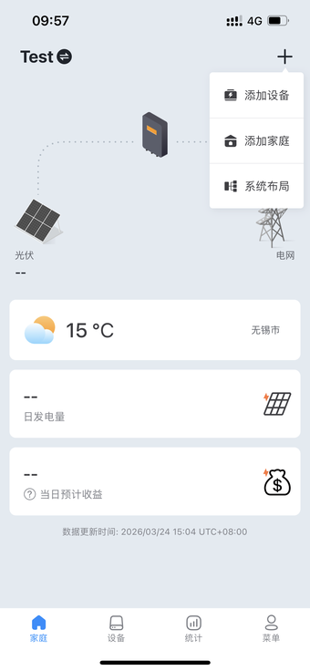

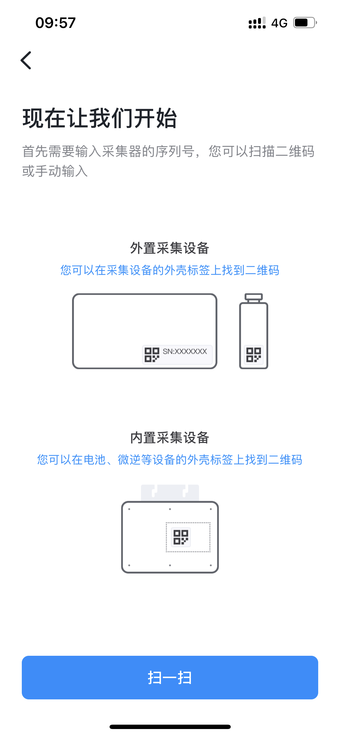

3. 请操作网络配置，输入 WiFi 名称和密码，点击确认，提示配置成功。

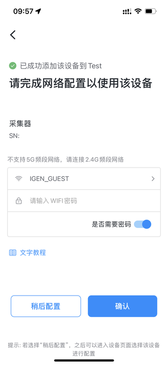

4. 设备成功连接网络后，点击确认跳转到设备页面，查看相关的数据。
