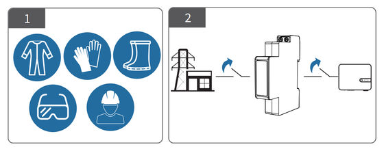
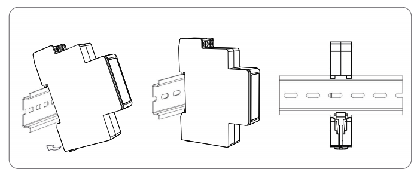
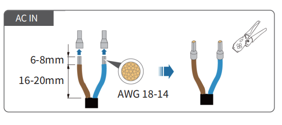
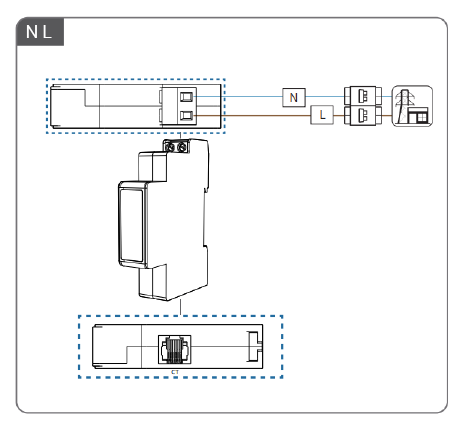
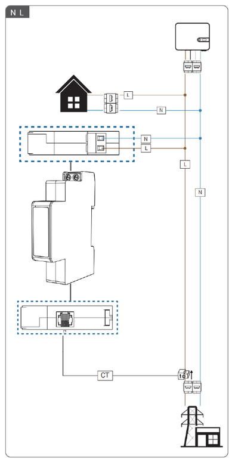

# 安装接线

## 单相电表安装步骤

（适用 MR1-D5-W、MR1-D5-WR）

### 安装工具

本产品需由有经验的电工或专业人员穿戴符合相关安全标准的专用防护用具进行安装。安装前，务必仔细阅读本说明书全文，并确保已完全理解所有安全事项和接线要求。

:::danger 警告
所有接线操作必须在完全断电并验明无电的条件下进行。严禁带电安装或接线。
:::

### 机械安装

- 根据电表的尺寸大小，在配电箱的 35mm 标准 DIN 导轨上规划安装位置，确保空间充足，便于接线和维护。
- 将电表背部卡槽对准导轨上沿，向下按压直至底部卡扣可靠锁紧在导轨上。为确保系统安全，配电箱内应配备适配的浪涌保护器（SPD）。

### 电气接线

1. 使用剥线钳剥除线端 6~8mm 的绝缘层，再使用与线径匹配的端子进行压接处理。

2. 按标识将零线（N）、电源火线（L）分别接入电表端子。

3. 将主火线（L）从 CT 孔中穿过。确保电源来线方向与 CT 上标记的 P1 侧一致。将电流互感器（CT）的端子连接至电表的 CT 端子。

4. 完成所有接线并反复确认无误后，方可恢复供电。通电后，观察电表电源指示灯是否常亮，确认电表是否已通电。

